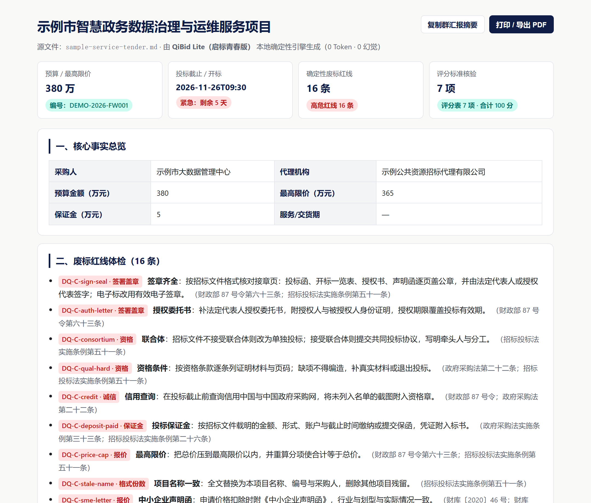

<div align="center">
  
  <h1>启标青春版（QiBid Lite）</h1>
  <p><strong>中国招投标确定性解析引擎 · <code>.docx</code> / <code>.pdf</code> / URL 废标红线体检 CLI · 零依赖标准 MCP Server</strong></p>
  <p>0 Token · 毫秒级 · 零幻觉抽取开标时间、预算限价、保证金、资格硬门槛、评分表与关键日程；输出可发群/发老板的一页纸 HTML 决策单，1 分钟接入 Cherry Studio / Cursor / Claude Desktop。</p>

  <p>
    <a href="./LICENSE"></a>
    <a href="https://nodejs.org">= 22.19" /></a>
    <a href="./package.json"></a>
    <a href="#mcp-server-接入指南"></a>
  </p>

  <p>
    <a href="https://qibid.lingqiai.online/try/?from=lite-readme"><strong>⚡ 免安装 10 秒在线试玩</strong></a>
    &nbsp;·&nbsp;
    <a href="https://qibid.lingqiai.online/download/?from=lite-readme"><strong>⬇️ 启标桌面完整版（14 天免费试用）</strong></a>
    &nbsp;·&nbsp;
    <a href="https://qibid.lingqiai.online/sources/?from=lite-readme"><strong>📡 查看 329 个一手源站名录</strong></a>
  </p>
</div>

---

## 一眼看效果：10 秒产出可转发群/老板的「投标一页纸决策单」

运行一条命令，即可对 `.docx` / `.pdf` / `.html` / `.md` / `.txt` 或公开公告 URL 输出本地单文件 HTML 体检单（含红黄绿风险条、100 分评分核验、法规出处、一键复制微信/钉钉群汇报摘要与打印 PDF）：

<div align="center">
  
</div>

---

## 为什么做 QiBid Lite？

市面上大量招投标 AI 脚本把 100~200 页招标文件直接扔给大模型“碰运气”，不仅慢、烧 Token，还极易把开标时间、最高限价、保证金和废标红线读漏读错。

**QiBid Lite** 开源了启标（QiBid）沉淀的**纯确定性招投标基础引擎（0 外部运行时依赖，clone 完直接跑，无需 `npm install`）**：

- **零依赖直读真实文件**：
  - **`.docx`**：纯 Node `zlib` 解析 ZIP 与原生 Word 表格，精准识别 4~6 列评分表（含「是否暗标 / 是否客观分」）；
  - **`.pdf`**：纯 Node `ToUnicode CMap`（`beginbfchar` / `beginbfrange`）解码中文文字版 PDF；自动按有效汉字密度识别**扫描件 / 影印版 PDF** 并诚实提示，绝不静默吐空报告；
  - **`.html` / `.md` / `.txt` 与公开公告 URL**：自动识别 UTF-8 / GB18030 / UTF-16，内置 SSRF 防护与登录墙 / 验证码自动识别；
- **毫秒级、零幻觉抽取**：
  - 68 份真实公开招标公告确定性评测集：开标时间 **100%（68/68）**、硬字段精确率 **100% / 召回率 99.2%**、废标与技术要点 **F1 = 0.970**；
  - 真实多列 `.docx` 招标文件实测（如 6 列政采评标办法）：精准抽出 **8 项、合计 100 分** 且主客观分全对；
  - 真实 89 页中文文字 PDF 招标文件实测：零外部依赖直接命中 **30 条废标红线**；
- **四大类废标红线规则库**：覆盖 **通用 / 货物 / 服务 / 工程** 高频废标条款，每条附带法规依据（财政部 87 号令、招投标法实施条例等）与整改动作；
- **批量横向对比（`batch`）**：一次扫完整个文件夹内多份招标文件，输出横向对比 HTML 与可直接用 Excel 打开的 UTF-8 BOM CSV；
- **零损耗接力完整版（`export-pack`）**：一键导出与启标桌面完整版同构的 `看标/` 目录 + `qibid-pack.json`，导入桌面版继续对接企业资质库写标与 17 类交标前预审，无需重复看标。

---

## 10 秒快速上手（无需 `npm install`）

> 前置要求：Node.js `>= 22.19.0`。本仓库已将全部运行时逻辑内联打包为单文件 ESM，**0 外部依赖**，clone 即可直接执行。

```bash
git clone https://github.com/JieX133/qibid-lite.git
cd qibid-lite

# 1. 体验内置脱敏服务标样例：生成可转发的「一页纸 HTML 决策单」
node bin/qibid-lite.mjs scan examples/sample-service-tender.md --html ./demo-report.html

# 2. 直接解析你手头的真实 .docx 招标文件、文本 PDF 或公开招标公告 URL
node bin/qibid-lite.mjs scan ./招标文件.docx --html ./report.html
node bin/qibid-lite.mjs scan ./招标文件.pdf --html ./report.html
node bin/qibid-lite.mjs scan https://example.gov.cn/notice.html --html ./report.html

# 3. 批量体检整个目录内多份标书，输出横向对比 HTML + Excel CSV
node bin/qibid-lite.mjs batch ./examples --html ./compare.html --csv ./compare.csv

# 4. 决定要投？导出标准交接目录（直接导入启标桌面完整版接力写标与预审）
node bin/qibid-lite.mjs export-pack examples/sample-service-tender.md --out ./my-bid-project

# 5. 一键运行仓库自带端到端自检（验证 CLI / DOCX / 扫描 PDF / SSRF / Batch / Pack / MCP）
node --test test/e2e.test.mjs
```

### 真实终端输出示例

```text
【投标一页纸速览】示例市智慧政务数据治理与运维服务项目
- 编号/采购人：DEMO-2026-FW001 ｜ 示例市大数据管理中心
- 预算/限价：380 万元 ｜ 截止：2026-11-26T09:30（距截止约 5 天）
- 硬性风险：识别 1 项资格条件、16 条废标红线、7 项评分标准（合计 100 分）
- 来源：QiBid Lite 本地确定性体检（0 幻觉）
```

---

## MCP Server 接入指南

QiBid Lite 内置零外部依赖的标准 **stdio JSON-RPC 2.0 MCP Server**，1 分钟即可挂载到主流 AI 客户端，让你的大模型先用确定性工具读准事实，再做研判与分析。

### Cherry Studio / Cursor / Claude Desktop / Cline 通用配置

```json
{
  "mcpServers": {
    "qibid-lite": {
      "command": "node",
      "args": ["/你的绝对路径/qibid-lite/bin/qibid-lite.mjs", "--mcp"]
    }
  }
}
```

- **Cherry Studio**：设置 → MCP 服务器 → 添加服务器 → 类型选 `STDIO`，命令填 `node`，参数填 `/绝对路径/qibid-lite/bin/qibid-lite.mjs` 与 `--mcp`。
- **Cursor**：写入项目 `.cursor/mcp.json` 或全局 `~/.cursor/mcp.json`。
- **Claude Desktop**：写入 `claude_desktop_config.json`（Windows 位于 `%APPDATA%\Claude\claude_desktop_config.json`）。

### 暴露的 7 个标准 MCP 工具

| 工具名 | 作用 | 主要参数 |
|---|---|---|
| `scan_tender` | 确定性抽取核心事实、评分项数、废标红线数与群汇报摘要；自动探测扫描版 PDF | `filePath` / `url` / `text`（三选一） |
| `check_disqualify` | 按通用 / 货物 / 服务 / 工程规则库逐条扫描废标红线（带法规与整改模板） | `filePath` / `text`，可选 `kind` |
| `extract_scoring` | 抽取结构化评分标准表（支持 `.docx` 原生多列表格，区分主客观分） | `filePath` / `text` |
| `extract_key_dates` | 提取获取截止、提疑截止、保证金到账、踏勘、开标与解密规则 | `filePath` / `text` |
| `batch_scan_dir` | 批量扫描文件夹内多份招标文件，可选导出对比 HTML / Excel CSV | `dirPath`，可选 `htmlOut` / `csvOut` |
| `export_qibid_pack` | 在本地生成兼容启标桌面完整版的 `看标/` 目录与 `qibid-pack.json` | `outDir` + `filePath`/`url`/`text` |
| `list_demo_sources` | 列出内置 12 个示范公开招投标源站 | 无 |

### 暴露的 3 个标准 MCP Prompts

- `tender-go-no-go`：一键投标立项可行性研判（自动串联 `scan_tender` + `check_disqualify` 输出决策单）
- `disqualify-audit`：废标红线逐条核查与避坑行动清单
- `scoring-breakdown`：评分表 100 分核验与「价格 / 商务客观分 / 技术主观分」应标分工拆解

---

## 青春开源版 vs 启标桌面完整版（工作流分工）

```text
[招标文件 .docx / .pdf / 公告 URL]
        │
        ▼  QiBid Lite（开源免费 · 0 Token · 毫秒级）—— 10 秒决定「投不投」
  1. 确定性看标、100 分评分表核验、废标红线初检
  2. 生成一页纸 HTML 决策单（复制摘要发群 / 打印 PDF 给老板）
  3. 决定要投 → qibid-lite export-pack 导出标准 看标/ 交接目录
        │
        ▼  启标桌面完整版（14 天全功能免费试用 · 本地留档）—— 把标书安全写完审完交出去
  4. 扫描版 PDF / 盖章件离线本地 OCR + 329 个一手源站与更正公告浮窗实时盯防
  5. 多主体企业资质/业绩/产品库 + 零编造事实写入闸 + 六问并行写长标书
  6. 17 类交标前 AI 预审 + 围串标防误伤（DOCX 元数据深度洗白 & 跨项目图片查重）+ 暗标实排核页
```

| 能力维度 | QiBid Lite（本开源仓库） | [启标桌面完整版](https://qibid.lingqiai.online/download/?from=lite)（14 天免费试用） |
|---|---|---|
| `.docx` / 文字 `.pdf` / `.html` / URL 确定性看标与日程抽取 | ✅ | ✅ |
| 通用 / 货物 / 服务 / 工程废标红线初检 & 批量横向对比 | ✅ | ✅ |
| 可转发 HTML 一页纸决策单 & 零依赖 MCP Server（7 工具 + 3 Prompts） | ✅ | ✅ |
| 扫描版 PDF / 盖章影印件离线本地 OCR + 视觉多模态识图 | ❌（自动识别并提示） | ✅（内置离线 OCR，文件不出本机） |
| 全国一手源站直采与更正公告自动盯防 | 仅 12 示范公开源 | ✅ **329 个源站（267 政采 + 62 央企/军队）** |
| 内置招投标侧栏浏览器（人工登录接管 + 自动下附件） | ❌ | ✅ |
| 零编造事实写入闸 + 多主体企业资质/业绩/产品库 | ❌ | ✅（查不到绝不编造，强制留「待填」） |
| 六问闭环 + 并行写长标书 + 暗标排版 + LibreOffice 真版面核页 | ❌ | ✅（实排自动回填真实目录页码） |
| 17 类交标前 AI 预审 + 模拟评委打分 + 围串标防误伤 | ❌ | ✅（导出自动洗白元数据 + 跨项目图片 dHash 查重） |
| 桌面置顶浮窗（常驻盯进度 / 截屏自动隐身） | ❌ | ✅ |

> 👉 **不想折腾命令行？**
> - 想先不装软件体验：[10 秒浏览器本地在线试玩（0 上传）](https://qibid.lingqiai.online/try/?from=lite-readme)
> - 想直接跑完整个投标闭环：[免费下载启标桌面完整版（14 天全功能免费试用，到期永不锁标书，导出 Word 绝不写水印）](https://qibid.lingqiai.online/download/?from=lite-readme)

---

## 能力边界与安全合规声明

- **扫描件与加密 PDF**：本仓库零依赖引擎仅处理文字层与标准 ToUnicode CMap；遇到扫描件、盖章影印件或特殊编码字体时会自动标记 `scanDetected: true` 并诚实提示，不编造内容。
- **严守网站访问边界**：URL 抓取仅支持公开可访问的 `http/https` 页面，内置内网/本机/云元数据 SSRF 阻断，**绝不绕过验证码、绝不爬取需登录页面**。
- **严守 87 号令合规红线**：仅用于投标人侧自查与效率提升，**绝不向任何用户 `.docx` 投标文件写入产品标识、授权码或设备指纹**。

---

## 仓库目录结构

```text
qibid-lite/
├── bin/qibid-lite.mjs        # CLI 与零依赖 MCP Server 入口
├── lib/
│   ├── readers.mjs           # 零依赖 .docx / ToUnicode PDF / HTML / URL 读取器与 SSRF 守卫
│   └── report.mjs            # 可分享一页纸 HTML 决策单 & 批量对比 HTML / CSV 渲染器
├── dist/entry.mjs            # 单文件内联确定性核心引擎（0 外部依赖）
├── core/                     # 确定性解析、评分、日程与废标规则 TypeScript 源码
├── examples/                 # 2 份脱敏示范招标文件（含 100 分评分表样例）
├── test/e2e.test.mjs         # 8 项零外部依赖端到端自检套件（node --test）
├── assets/                   # Brand A 标识与真实决策单预览图
└── LICENSE                   # AGPL-3.0-or-later + 商业双许可说明
```

## 许可与商业授权

本仓库采用 **AGPL-3.0-or-later + 商业双许可**（详见 [LICENSE](./LICENSE)）。  
个人与企业内部自用完全免费；在线 SaaS / 闭源商业集成请前往 [启标官网](https://qibid.lingqiai.online/pricing/?from=lite-license) 联络官方获取商业授权。
